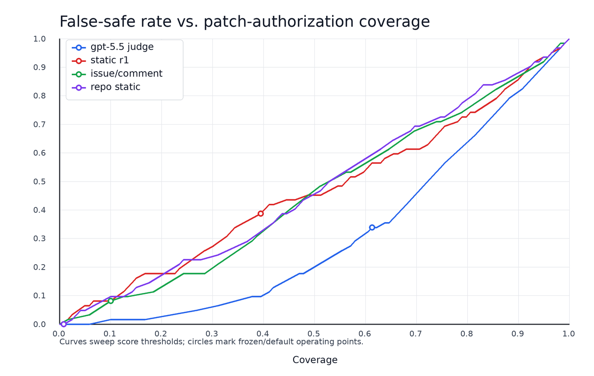

# NotPatch Audit Guide

This guide is the row-level companion to the article *NotPatch: When "Resolved" Does Not Establish Patch Decidability in Repository-level Program Repair*.
The article cites its sections as "replication package, audit A1" through "audit A8".
Every estimand, headline estimate, and claim boundary is stated in the article; this guide adds the procedures, row-level tables, and robustness details behind them and does not introduce new claims.

Generated tables are rendered from the same LaTeX files that the analysis scripts write under `paper/generated/`.
`reproduce.py` regenerates those files, renders this guide again (step `audit`), and compares it byte for byte with `MANIFEST.json`.
The three hand-written tables (A7 and A8) summarize the cited records and are not regenerated.

| Section | Contents | Article | Reproduce steps |
| --- | --- | --- | --- |
| A1 | Nested 120-row audit and raw reliability | Section 5.1.3 | `prevalence`, `reporting_diagnostics` |
| A2 | Primary-frame sensitivity and validation-panel exposure | Section 5.1.2 | `prevalence`, `boundary_validation`, `bv_prior_exposure`, `transition` |
| A3 | Bidirectional construct-validity audit | Section 5.1.4 | `construct_validity` |
| A4 | P1 non-strict and boundary-discordance typology | Sections 4.2, 5.1.2, and 5.1.4 | `p1_typology`, `rre_verification`, `rre_adjudication` |
| A5 | Expanded repository-view audit | Sections 4.2, 5.1.4, and 5.2 | `expanded_retrieval` |
| A6 | External-frame sensitivity on SWE-bench-Live | Section 5.1.3 | `external_frame` |
| A7 | RQ2 oracle-masking audit | Section 5.2 | `rq2_masking`, `rq2_control` |
| A8 | Pre-revision detector and utility diagnostics | Sections 4.5 and 5.3 | Archived summaries, not regenerated |

Experts appear only under stable role IDs (for example `repo480_r1`); the article's provenance table lists every role.
Rationales in the annotation records are partly written in Korean, while field names, labels, and codes are in English.

## A1. Nested 120-row audit and raw reliability

**Role.** The article reports the nested first 120 ranks as a reliability and row-audit view and gives the raw agreement statistics in text (Section 5.1.3).
The nested subset is not an independent sample or a replacement prevalence estimate.

**Procedure.** The nested subset contains the first 120 random ranks of the same 480-task frame and uses the same two raw reviewers (`repo480_r1`, `repo480_r2`) and third-reviewer adjudication (`repo480_adj`).
The first two tables report raw and adjudicated counts and intervals for the nested subset and list all eight adjudicated P2/P3 rows without introducing post-hoc oracle evidence.
The third table reports raw reliability over all 480 rows before adjudication.

**Table: Reliability of the nested 120-row repository-packet audit.**

| Measure | Count | Estimate |
| --- | --- | --- |
| Adjudicated P2/P3 | 8/120 | 0.067 [0.034, 0.126] Wilson |
| Raw reviewer 1 P2/P3 | 6/120 | 0.050 [0.023, 0.105] Wilson |
| Raw reviewer 2 P2/P3 | 18/120 | 0.150 [0.097, 0.225] Wilson |
| Raw intersection P2/P3 | 6/120 | 0.050 [0.023, 0.105] Wilson |
| Raw union P2/P3 | 18/120 | 0.150 [0.097, 0.225] Wilson |
| Raw binary agreement | 108/120 | 0.900; κ=0.459 |
| Raw exact-label agreement | 85/120 | 0.708; κ=0.508 |

**Table: All adjudicated P2/P3 rows in the nested 120-task repository-packet audit.**

| Task | Issue baseline | R1 | R2 | Final | Blocker | Retrieval |
| --- | --- | --- | --- | --- | --- | --- |
| `sympy__sympy-15596` | P2 | P2 | P2 | P2 | U2 | insufficient |
| `scikit-learn__scikit-learn-14024` | P1 | P2 | P2 | P2 | U2 | sufficient |
| `sphinx-doc__sphinx-9665` | P2 | P2 | P2 | P2 | U2 | sufficient |
| `sympy__sympy-13346` | P1 | P1 | P2 | P2 | U2 | insufficient |
| `matplotlib__matplotlib-23740` | P2 | P1 | P2 | P2 | U2 | sufficient |
| `sympy__sympy-22402` | P2 | P2 | P2 | P2 | U2 | sufficient |
| `scikit-learn__scikit-learn-13641` | P2 | P2 | P2 | P2 | U2 | sufficient |
| `astropy__astropy-14253` | P2 | P2 | P2 | P2 | U2 | sufficient |

**Table: Raw reliability before adjudication.**

| Unit | Agreement | κ | PABAK / weighted κ | AC1 |
| --- | --- | --- | --- | --- |
| Binary boundary | 430/480 | 0.403 | 0.792 | 0.875 |
| Exact P0–P3 | 342/480 | 0.506 | 0.554 / 0.618 | 0.644 |
| Primary blockera | 124/277 | — | — | — |

aRows where at least one raw reviewer records a blocker. Exact-label weighted values are linear/quadratic.

**Records.** Raw passes `data/annotations/raw_labels/repo480_available_v1_r1.jsonl` and `repo480_available_v1_r2.jsonl`; adjudication decisions `data/annotations/adjudication_decisions/repo480_available_v1.jsonl`; adjudicated labels `data/annotations/adjudicated/repo480_available_v1.jsonl`; analyses `results/pilot/repo480_available_v1_prevalence_analysis.{json,md}` and `results/pilot/repo480_reporting_diagnostics_v1.{json,md}`.

## A2. Primary-frame sensitivity and validation-panel exposure

**Role.** The article reports the frozen adjudication rule (26/480) and the separately staffed validation panel (0.094 [0.084, 0.124]) as members of one rule-sensitivity family (Section 5.1.2).
This section adds the exposure details behind the reverted-label sensitivity.
The table repeats article Table 5.

**Procedure.** The validation panel samples all 70 rows in the original raw-pass P2/P3 union and 150 of the 410 raw-consensus P0/P1 rows; stratum proportions are combined with the known frame weights under a finite-population correction (article Section 4.3).
Because the validation interval excludes 0.054, the prespecified rule retains both estimates as members of a rule-sensitivity family.
The three validation-panel experts had earlier filled the construct-validity raw roles, whose packages showed the oracle patch and tests with the locked label and direction or candidate set for 70 of the 220 validation rows (all 26 frozen P2/P3 rows and 44 frozen P0/P1 rows); no validation row records a protocol deviation.
Binary agreement with the frozen boundary is 58/70 on these rows and 140/150 on the others, but the split is not randomized because the exposed rows include every frozen P2/P3 row.
Reverting the 70 rows to their frozen labels gives 0.086 [0.078, 0.114], which still excludes 0.054; this removes genuine as well as exposure-driven disagreement, so it is a sensitivity rather than a corrected estimate.
Among the 44 exposed frozen-P0/P1 rows, the panel assigned P2/P3 to 5 of the 17 whose locked direction the audit judged partial or mismatch and to 2 of the 27 judged a match, a pattern consistent with exposure influence and with genuine ambiguity.
Raw reviewer, intersection/union, issue-packet transition, and repository-cluster results remain separate uncertainty families and are not combined into one interval.

**Table: RQ1 prevalence estimates and sensitivities under the frozen repository packet.**

| Analysis | P2/P3 | Estimate / 95% interval |
| --- | --- | --- |
| *Frozen adjudication rule (row-level random sample)* |  |  |
| Adjudicated repository packet (480) | 26/480 | 0.054 [0.037, 0.078] Wilson |
| *Separately staffed validation panel (census 70 + sample 150/410)* |  |  |
| Adjudicated stratified estimate | 34/70; 4/150 | 0.094 [0.084, 0.124] FPCa |
| Repository-cluster bootstrapb | — | [0.041, 0.185] |
| Raw validation intersection / union | — | 0.069 / 0.178 stratified |
| *Reviewer-rule sensitivity on the same 480 rows* |  |  |
| Raw reviewer 1 | 22/480 | 0.046 [0.030, 0.068] Wilson |
| Raw reviewer 2 | 68/480 | 0.142 [0.113, 0.176] Wilson |
| Raw intersection | 20/480 | 0.042 [0.027, 0.063] Wilson |
| Raw union | 70/480 | 0.146 [0.117, 0.180] Wilson |
| *Nested audit and evidence-policy sensitivity* |  |  |
| Nested 120 adjudicated audit | 8/120 | 0.067 [0.034, 0.126]; audit only |
| Issue-packet baseline (same 480) | 57/480 | 0.119 [0.093, 0.151] Wilson |
| *Repository concentration sensitivity* |  |  |
| Equal-repository weighted / cluster bootstrapb | — | 0.044; [0.031, 0.087] |

aWilson score with finite-population correction in the sampled original raw-consensus P0/P1 stratum; the original raw-union P2/P3 stratum is a census. bRepository percentile bootstrap with 10,000 resamples (12 repositories and seed 20260720 for the frozen frame; 11 repositories and seed 20260818 for the validation panel). Families are reported separately, not combined into one interval.

**Records.** Validation-panel returns, adjudication, and adjudicated labels in `data/annotations/oracle_gap/repo480_boundary_validation_panel/`; stratified selection `data/annotations/worklists/repo480_boundary_validation_selection_v1.jsonl`; analyses `results/pilot/repo480_boundary_validation_analysis_v1.{json,md}`, `results/pilot/repo480_bv_prior_exposure_sensitivity_v1.{json,md}`, and `results/pilot/repo480_available_v1_transition_analysis.{json,md}`; row-level labels and subset membership for all 480 rows in `results/pilot/repo480_available_v1_prevalence_rows.jsonl`.

## A3. Bidirectional construct-validity audit

**Role.** The article reports the primary outcomes in Table 7 and the label strata in text (Section 5.1.4).
This section adds the stratum table.

**Procedure.** The audit freezes the first-120-rank P0/P1 subset (112 rows) for predicted-direction checks and all 26 repository-packet P2/P3 rows for hindsight-uniqueness checks before any oracle review.
Three experts (`repo480_cv_r1` to `repo480_cv_r3`) compare the locked direction or candidate set with the oracle patch and tests, and `repo480_cv_adj` adjudicates every field without exact consensus.
The tables separate strict match, match-or-partial, mismatch, dispute-as-adverse, Q0-only, and oracle-in-candidate-set diagnostics.
These post-hoc fields do not revise the available-only P-labels.
The protocol is `docs/construct_validity_audit_protocol.md`.

**Table: Bidirectional construct-validity audit of the available-only labels.**

| Analysis | Count | Estimate / Wilson 95% CI |
| --- | --- | --- |
| P0/P1 predicted direction match | 76/112 | 0.679 [0.587, 0.758] |
| &emsp; match or partial | 100/112 | 0.893 [0.822, 0.938] |
| &emsp; mismatch (false confidence) | 12/112 | 0.107 [0.062, 0.178] |
| &emsp; dispute as adverse | 71/112 | 0.634 [0.542, 0.717] |
| &emsp; Q0 only | 76/111 | 0.685 [0.593, 0.764] |
| P2/P3 hindsight uniqueness (false pessimism) | 0/26 | 0.000 [0.000, 0.129] |
| &emsp; oracle direction in candidate set | 19/26 | 0.731 [0.539, 0.863] |
| &emsp; Q0 only | 0/25 | 0.000 [0.000, 0.133] |

**Table: P0/P1 direction-match outcomes in the frozen 112-row subset.**

| Label | n | Match | Partial | Mismatch |
| --- | --- | --- | --- | --- |
| P0 | 65 | 52 | 10 | 3 |
| P1 | 47 | 24 | 14 | 9 |

**Records.** Raw returns and adjudication in `data/annotations/oracle_gap/repo480_construct_validity_panel/`; worklists `data/annotations/worklists/repo480_construct_validity_tasks_v1.jsonl` (ships as `.xz`) and `repo480_construct_validity_adjudication_worklist_v1.jsonl`; manifest `data/manifests/generated/repo480_construct_validity_adjudication_manifest_v1.json`; analysis `results/pilot/repo480_construct_validity_analysis_v1.{json,md}` and 138 audit rows in `results/pilot/repo480_construct_validity_rows_v1.jsonl`.

## A4. P1 non-strict and boundary-discordance typology

**Role.** The article reports the final type counts for the non-strict P1 rows, the pre-adjudication agreement, and the main boundary-discordance types (Sections 5.1.2 and 5.1.4).
This section gives the procedure, the initial and final distributions, the what-if rates, and the exposure disclosures.

**Procedure.** The typology examines two sets of existing records without collecting new evidence: the 23 P1 rows whose locked direction did not strictly match the oracle (Set A) and the 22 sampled rows where the frozen and validation boundaries disagree (Set B).
A codebook fixed before coding (`docs/repo480_p1_boundary_typology_codebook.md`) defines the coded fields, and each type is derived from those fields by an ordered rule rather than chosen directly.
The boundary-discordant rows use available-only records; each initial coder completed them before opening the P1 oracle material.
The first pass (c1) was AI analytic coding, not expert annotation; its distribution is the first table below.
An expert (c2) independently coded the same records without seeing that pass or its results, and another expert adjudicated only the ten derived-type disagreements, all in Set A, with both original codings visible.
Pre-adjudication agreement was 13/23 for Set A (0.565; Wilson 95% CI [0.368, 0.744]; κ=0.444) and 22/22 for Set B (1.000; [0.851, 1.000]; κ=1.000).
Final types combine agreements and adjudications; controlled fields and secondary types were not fully adjudicated, so their distributions remain coder-specific sensitivities.
Intervals describe selected rows without repository-cluster adjustment; the sets share five tasks and are not pooled.
No available-only label, prevalence estimate, or construct-audit outcome changes.

**Set A findings.** Thirteen non-strict P1 rows involve observably different behaviors that the packet left open and the hidden test fixed.
Four choices were recorded as bounded assumptions; nine unanticipated alternatives are boundary-displacement candidates.
Two rows reflect evidence-reading problems, reversing the initial pass's zero count; five involve oracle scope beyond the issue, one the same contract, and two remain undeterminable.
The latter retain conflicting packet descriptions or missing JavaScript behavior evidence, not missing adjudications.
The validation panel labeled 2 of the 9 contract-choice rows it covered as P2/P3; it had seen all nine with their oracle during the construct-validity audit.
Moving the 9 unanticipated rows, or all 13 contract-choice rows, from the 47 sampled P1 rows and scaling to the 185 frame P1 rows gives what-if rates 0.128 or 0.161, neither bounds nor corrected estimates.
The raw AI/expert sensitivities are respectively 0.103/0.136 for unanticipated choices and 0.185/0.161 for all choices.

**Exposure.** The verification expert disclosed prior memories in 15 Set B rows and hints or post-hoc discussion embedded in four Set A rationales, stating these were not coding evidence.
Three of those Set A rows entered adjudication, where both coders' exposure notes were also visible.
The adjudicator's ten empty exposure fields were normalized to null only after expert confirmation relayed by the coordinator; the received original is preserved.
These null entries do not establish absence of inherited exposure, whose effect remains unknown.
The verification expert held no other role and wrote none of the coded records; the adjudicator had been an RQ2 raw reviewer, and the RQ2 rows (frozen P2/P3) are disjoint from the frozen-P1 Set A rows.

**Set B findings.** Of the 22 boundary-discordant rows, 20 lie between P1 and P2 and 17 are P0/P1 under the frozen rule but P2/P3 in the validation panel.
Twelve of them are among the 70 rows the validation panel had seen during the construct-validity audit.
Twelve disagreements concern whether an alternative that both outcomes acknowledge, such as a reporter's fallback, a no-change response, or an API default, is a separate target.
Six reflect different readings of the same cited evidence, and four arise from packet evidence that one outcome did not use.
A future codebook version could treat a residual choice that changes a tested observable as a separate target unless packet evidence selects one; this candidate is not applied retroactively.

**Table: Typology of the 23 non-strict P1 rows and the 22 boundary-discordant rows (single coding pass; diagnostic counts).**

| Non-strict P1 rows | Partial | Mismatch | Total |
| --- | --- | --- | --- |
| (a) Same contract, implementation or scope detail | 1 | 0 | 1 |
| (b) Contract choice named as a P1 bounded assumption | 5 | 5 | 10 |
| (b) Contract choice not named in the P1 record | 3 | 3 | 6 |
| (c) Task-time evidence misread or omitted | 0 | 0 | 0 |
| (d) Oracle or packaging beyond the issue | 5 | 1 | 6 |
| Undeterminable | 0 | 0 | 0 |

| Boundary-discordant rows | Frozen P0/P1 | Frozen P2/P3 | Total |
| --- | --- | --- | --- |
| Evidence utilization | 3 | 1 | 4 |
| Rule threshold | 10 | 2 | 12 |
| Case judgment | 4 | 2 | 6 |
| Undeterminable | 0 | 0 | 0 |

**Table: Final RR-E types and raw-coder sensitivity.**

| Type | Final | c1 | c2 | Wilson 95% CI |
| --- | --- | --- | --- | --- |
| **Set A (n=23)** |  |  |  |  |
| Same contract | 1 | 1 | 1 | [0.008, 0.210] |
| Contract choice: anticipated | 4 | 10 | 3 | [0.070, 0.371] |
| Contract choice: unanticipated | 9 | 6 | 10 | [0.222, 0.592] |
| Evidence reading | 2 | 0 | 2 | [0.024, 0.268] |
| Oracle scope | 5 | 6 | 4 | [0.097, 0.419] |
| Undeterminable | 2 | 0 | 3 | [0.024, 0.268] |
| **Set B (n=22)** |  |  |  |  |
| Evidence utilization | 4 | 4 | 4 | [0.073, 0.385] |
| Rule threshold | 12 | 12 | 12 | [0.347, 0.731] |
| Case judgment | 6 | 6 | 6 | [0.132, 0.482] |
| Undeterminable | 0 | 0 | 0 | [0.000, 0.149] |

**Records.** Codes in `data/annotations/typology/` (`c1` AI analytic pass, `c2_seta` and `c2_setb` expert verification, `adj_received` the adjudication as received, `adj` the normalized adjudication); worklist `data/annotations/worklists/repo480_p1_typology_worklist_v1.jsonl`; analyses `results/pilot/repo480_p1_non_strict_typology_v1.{json,md}`, `results/pilot/repo480_rre_verification_analysis_v1.{json,md}`, and `results/pilot/repo480_rre_final_typology_v1.{json,md}` with their row files.

## A5. Expanded repository-view audit

**Role.** The article reports the label changes and the 22/480 what-if as a post hoc sensitivity (Section 5.1.4) and the RQ2 cross-reference (Section 5.2).
The audit is one expanded-only pass without a paired frozen-view pass by the same expert, so it does not estimate a causal retrieval effect.

**Procedure.** This post hoc sensitivity re-examines all seven frozen P2/P3 rows whose retrieval was marked insufficient (five) or unclear (two); no row is excluded.
One expert (`repo480_retrieval_r1`) received each frozen packet together with every regular UTF-8 text file at the same base commit, without category quotas, ranking, or size limits, while original labels, selection criteria, oracle fields, and outcomes stayed hidden.
Public comments and links kept their frozen unavailable status, and search terms had to come from the issue or from permitted material already read.
For each row the expert recorded a P0–P3 label, data quality, candidate directions, a search trace, cited lines, and whether the widened evidence was newly decisive, corroborating, or still insufficient.
All 64 quotations resolve to the cited lines, and 41 cite files or lines that the frozen packet did not contain.
One row (R07) self-reports a search term chosen from general knowledge rather than permitted material; it is retained, and excluding it leaves the four label changes and the what-if below unchanged.

**Findings.** Three rows remain P2/P3 and four become P1 (4/7; Wilson 95% CI [0.250, 0.842], descriptive only).
The expert attributes only R01 to decisive evidence outside the frozen packet; for the other three P1 rows the decisive text was already in the packet, so interpretation differences between judges are the more direct explanation.
R06 and R07 remain P2 although retrieval became sufficient, because a maintainer must still choose between observably different compatibility or feature scopes; R04 remains P3 because the expert found no trace of the referenced reproduction in the repository text.
Substituting the expanded labels gives 22/480, or 21/477 in the Q0 frame defined by the frozen data-quality labels; because only P2/P3 rows were re-examined, this what-if can only lower the numerator and is neither a corrected estimate nor a bound.
The frozen and expanded judgments place different rows in Q2 (R04 versus R05), so the released analysis reports Q0 sensitivities under both memberships.

**Cross-references.** Two cross-references were added after the protocol was fixed.
The validation panel had labeled three of the four changed rows P2/P3 and R05 P0, and all three retained rows P2/P3.
Four rows belong to the RQ2 frame: R01, R02, and R05, including both worked examples, become P1, while R04 stays P3.
Removing those three rows leaves 9/9 original-panel and 8/9 matched-treated strict calls, but the eight remaining RQ2 rows were not flagged or re-examined, so RQ2 stays defined on frozen-packet labels.
In the table, outside references cite files or lines absent from the frozen packet, the validation column gives the validation panel's adjudicated label, and the RQ2 column gives original-panel and matched-treated strict calls.

**Table: Expanded-view audit of the seven retrieval-flagged P2/P3 rows.**

| Item | Task | Frozen, retrieval | Expanded, Q | Outside/all refs | Evidence role | Validation | RQ2 strict |
| --- | --- | --- | --- | --- | --- | --- | --- |
| R01 | `sympy__sympy-15596` | P2, insufficient | P1, Q0 | 7/9 | New decisive | P2 | yes/yes |
| R02 | `sympy__sympy-13346` | P2, insufficient | P1, Q0 | 11/14 | Corroboration | P2 | yes/yes |
| R03 | `sympy__sympy-18116` | P3, unclear | P1, Q0 | 5/10 | Corroboration | P3 | – |
| R04 | `sympy__sympy-16052` | P3, insufficient | P3, Q0 | 3/8 | Still insufficient | P3 | yes/yes |
| R05 | `django__django-15993` | P3, unclear | P1, Q2 | 3/9 | Corroboration | P0 | yes/no |
| R06 | `sympy__sympy-13988` | P2, insufficient | P2, Q0 | 5/6 | Still insufficient | P2 | – |
| R07 | `django__django-13207` | P2, insufficient | P2, Q0 | 7/8 | Still insufficient | P2 | – |

**Records.** Expert return `data/annotations/expanded_retrieval/repo480_retrieval_r1_v1.jsonl`; selection `data/annotations/worklists/repo480_unbudgeted_retrieval_selection_v1.jsonl`; analysis `results/pilot/repo480_unbudgeted_retrieval_sensitivity_v1.{json,md}` and `results/pilot/repo480_unbudgeted_retrieval_audit_rows_v1.jsonl`.
Re-running the step needs the release asset `repo480_unbudgeted_sources_v1.zip`.

## A6. External-frame sensitivity on SWE-bench-Live

**Role.** The article reports the prespecified transfer checks R2 and R3 (Section 5.1.3).
The adjudicated P2/P3 count describes this frame only and is neither combined with nor tested against 26/480 or 0.094.

**Procedure.** This prespecified sensitivity applies the frozen repository-evidence contract to one further Python frame.
The sample is the first 120 eligible tasks, in seeded random order (seed 20261021), of the SWE-bench-Live lite split at dataset revision `b51a8642`; it spans 52 repositories, 13 tasks come from SWE-bench repositories, and no task was excluded or replaced.
Packets keep the repo480 component boundaries, retrieval algorithm and parameters, category quotas, and size limits under a separate packet-policy identifier, and they passed the same clean-versus-offline replay gate.
Two independent experts labeled all 120 packets available-only with the frozen codebook, and a third expert adjudicated the 119 rows whose controlled fields differed; the one exact-agreement row keeps the first pass.
These are the same three experts as the repository-packet RQ1 roles, so comparisons with repo480 hold the panel fixed and are not a cross-panel replication.
The frame, sample, panel, and decision rules R1–R3 were fixed before sampling (`docs/rrl_external_frame_protocol.md`).

**Applicability (R1).** All 120 packets materialized; public comments are unavailable for every task as in repo480, and linked artifacts are materialized for 6, empty for 61, and unavailable for 53.
The fix-PR opening time is verified for 110 tasks and unverified for 10 whose repositories later moved to another organization.
At frame level, the frozen path classifier recognizes 577/617 test paths in the 300-task split (0.935), compared with 926/926 in the repo480 source draw.

**Retrieval (R2).** Adjudicated retrieval is insufficient or unclear for 41/120 rows (0.342; Wilson 95% CI [0.263, 0.430]).
Its lower bound exceeds 0.247, the upper bound of the repo480 interval for 100/480, which the prespecified rule reports as weak transfer of the frozen retrieval policy; the margin is 0.016.
The raw passes flag 44/120 and 28/120 rows, so the rule holds for the first pass but not the second, and rows flagged by both passes (27/120) do not meet it either.
Retrieval sufficiency is not a controlled field, so the adjudicator never overrode it and each post-adjudication value is the base pass's raw value.
Excluding rows with any raw or adjudicator protocol deviation gives 31/94 ([0.243, 0.430]), which no longer meets the rule.
In a post hoc description, the flag rate is similar among adjudicated P2/P3 rows (7/19) and P0/P1 rows (34/101), so more frequent retrieval flags did not accompany more non-decidable labels.

**Reproducibility (R3).** The raw passes agree on 104/120 binary labels (0.867; [0.794, 0.916]).
The upper bound is not below 0.865, the lower bound of the repo480 interval for 430/480, so no large drop is detected.
Cohen's κ is 0.457 and PABAK 0.733; exact P0–P3 agreement is 68/120, and 35 of the 52 exact-label disagreements lie between P0 and P1.
Of the 16 binary disagreements, 12 place the first pass at P2/P3.

**Labels and exposure.** After adjudication, 19/120 rows are P2/P3 (0.158; [0.104, 0.234]; repository-cluster bootstrap [0.083, 0.240]), with raw marginals 21/120 and 13/120.
Data quality is Q0 for 108 rows and Q2 for 12.
The first raw pass records prior recall of the upstream resolution for 13 rows and the adjudicator for 25 decisions; excluding the raw-deviation rows gives 93/107 binary agreement and 36/107 flagged rows, and the Q0-only view gives 98/108 and 36/108.
Both raw passes cite repository code, tests, documentation, or configuration on at least 119/120 rows.
At this sample size the two rules detect differences of roughly ten percentage points; they are not equivalence tests and do not extend the findings beyond this Python frame.

**Table: RR-L external-frame sensitivity: SWE-bench-Live lite, 120 rows under the frozen evidence contract (prespecified rules; Wilson 95% intervals).**

| Rule / metric | RR-L value | Repo480 reference | Reading |
| --- | --- | --- | --- |
| R1 applicability | 120/120 packets; fix-PR time verified 110; test paths recognized 0.935 | – | Descriptive |
| R2 adjudicated retrieval insufficient/unclear | 41/120 [0.263, 0.430] | 100/480 [0.174, 0.247] | Weak transfer |
| &emsp; raw passes r1 / r2 | 44/120 [0.286, 0.456] / 28/120 [0.167, 0.317] | – | Descriptive |
| R3 raw binary agreement | 104/120 [0.794, 0.916] | 430/480 [0.865, 0.920] | No large drop |
| &emsp; κ / PABAK / exact P0–P3 | 0.457 / 0.733 / 68/120 | – | Descriptive |
| Adjudicated P2/P3 (frame-specific) | 19/120 [0.104, 0.234]; cluster [0.083, 0.240] | not compared | Descriptive |
| &emsp; excluding raw/adjudicator deviation rows | R2 31/94 [0.243, 0.430]; R3 85/94 [0.828, 0.949] | – | Descriptive |

**Records.** Frame `data/processed/dataset_splits/swebench_live_lite_ext120.json`; raw passes, adjudication decisions, and post-adjudication labels in `data/annotations/external_frame/`; reviewer views `external/notpatch_evidence/swebench-live-lite-ext120-v1/clean/reviewer_views.jsonl` (ships as `.xz`); analysis `results/pilot/rrl_ext120_external_frame_analysis_v1.{json,md}` and `results/pilot/rrl_ext120_external_frame_rows_v1.jsonl`.

## A7. RQ2 oracle-masking audit

**Role.** The article reports the original-panel and matched-panel results and two worked rows (Section 5.2; Tables 8–10).
This section adds the worked-example trace, the discordant matched-panel rows, and the frozen run pool.

**Procedure.** RQ2 contains the 12 repository P2/P3 tasks resolved by at least one frozen public full-test run.
The strict call is derived from alternative-fix existence and hindsight non-uniqueness; it is not directly entered by a reviewer.
The conservative column treats every task with any raw controlled-field disagreement as non-masked.
The matched validation panel repeats the instrument on those 12 treated rows and 24 solved P0/P1 controls in one arm-blinded worklist.

**Table: RQ2 strict oracle masking and sensitivity.**

| Analysis | Masked | Estimate / Wilson 95% CI |
| --- | --- | --- |
| Primary strict | 12/12 | 1.000 [0.758, 1.000] |
| Any field dispute as non-masked | 9/12 | 0.750 [0.468, 0.911] |
| Q0 only | 11/11 | 1.000 [0.741, 1.000] |

**Table: All benchmark-solved repository P2/P3 rows in the RQ2 panel.**

| Task | In set | Gap | Alt. | Unique | Targets | Q | Strict | Conserv. |
| --- | --- | --- | --- | --- | --- | --- | --- | --- |
| `sympy__sympy-15596` | yes | yes | yes | no | 2-3 | Q0 | yes | yes |
| `scikit-learn__scikit-learn-14024` | yes | yes | yes | no | 2-3 | Q0 | yes | yes |
| `sympy__sympy-13346` | yes | partial | yes | no | many | Q0 | yes | no |
| `matplotlib__matplotlib-23740` | yes | yes | yes | no | 2-3 | Q0 | yes | yes |
| `scikit-learn__scikit-learn-13017` | yes | yes | yes | no | 2-3 | Q0 | yes | yes |
| `sympy__sympy-14333` | yes | yes | yes | no | 2-3 | Q0 | yes | yes |
| `sympy__sympy-16052` | yes | yes | yes | no | many | Q0 | yes | no |
| `django__django-15993` | no | no | yes | no | 2-3 | Q1 | yes | yes |
| `sympy__sympy-17770` | yes | yes | yes | no | many | Q0 | yes | yes |
| `sphinx-doc__sphinx-9829` | yes | yes | yes | no | 2-3 | Q0 | yes | yes |
| `pytest-dev__pytest-10552` | yes | partial | yes | no | 2-3 | Q0 | yes | no |
| `pylint-dev__pylint-5595` | yes | yes | yes | no | 2-3 | Q0 | yes | yes |

**Table: Matched negative-control validation of the RQ2 strict masking rule.**

| Analysis | Masked | Estimate / 95% interval |
| --- | --- | --- |
| Solved P2/P3 treated | 10/12 | 0.833 [0.552, 0.953] Wilson |
| Matched solved P0/P1 control | 5/24 | 0.208 [0.092, 0.405] Wilson |
| Control minus treated | — | -0.625 [-0.875, -0.143] cluster bootstrap |

*Notes:* The same blinded panel labels both arms. The contrast interval exhaustively enumerates all ordered resamples of seven repository clusters. The separately staffed original RQ2 panel remains 12/12 and is not pooled with this matched-panel replication.

**Worked Q0 example.** The table below traces one retrieval-sufficient Q0 row from the locked Phase 1 candidates to the hidden-test expectation.
Both raw passes of the original and matched panels record the same controlled fields for this row, so it illustrates the strict rule without depending on adjudication.
The rows `sympy__sympy-15596` and `django__django-15993` are retrieval-flagged and become P1 in the expanded-view audit; the article uses the latter only to show the Q1 boundary.
For `sympy__sympy-15596`, the cutoff issue asks whether degree on a rational expression should fail; Phase 1 preserves raise, warn while retaining the value, and rational-function degree, and the oracle selects the raise alternative.

**Table: Worked Q0 example: `scikit-learn__scikit-learn-13017` (hand-written from the panel records).**

| Candidate | Observable behavior | Cutoff evidence | Hidden-test expectation |
| --- | --- | --- | --- |
| A: normalize | `[-1]` selects the same column as `[2]`, and the passthrough remainder no longer repeats that column | The expected-results section accepts “the same result as” the positive-index transformer | `test_column_transformer_negative_column_indexes` asserts equal `fit_transform` output; A passes |
| B: reject | A negative integer column index raises a clear validation error | The same sentence accepts that the transformer “should either raise an error”; the retrieved `_column_transformer.py` has no explicit negative-index handling or documentation that excludes B | The same assertion cannot pass because B produces no output |

In both panels, both raw passes lock A and B in Phase 1 and record oracle direction in set, alternative fix, no hindsight uniqueness, a 2–3 target space, and Q0. The maintainer's decision to support negative indices appears in the issue hints, which the packet contract withholds together with the patch and tests.

**Discordant matched-panel rows.** The next table lists the five matched-panel control positives and the two treated rows that lose the strict call relative to the original panel's 12/12.
The readings summarize the recorded Phase 1, Phase 2, and adjudication rationales; they are descriptive and do not form an additional expert-coded typology.
All five control positives arise at the P1/P2 threshold: the frozen record and the panel see related alternatives but disagree on whether one is a separate behavior target.
None involves prohibited evidence or a protocol deviation.

**Table: Matched-panel control positives and treated rows without a strict call (hand-written from the panel records).**

| Task | Arm, frozen label | Alt. / unique / Q | Reading of recorded rationales |
| --- | --- | --- | --- |
| `matplotlib__matplotlib-23563` | Control, P1 | yes / no / Q0 | The frozen record fixes a usable follow-up plot and bounds only how the failing call fails; the panel also keeps accepting the input, which the oracle chooses for N×1 coordinates. |
| `django__django-11356` | Control, P1 | yes / no / Q0 | The frozen record calls a constructor error versus a system check a maintainer-convention choice within one target; the panel treats them as distinct workflows, and the oracle raises in the constructor. |
| `sympy__sympy-16221` | Control, P1 | yes / no / Q0a | The frozen record takes the existing matrix printers as fixing the syntax and bounds type coverage; neither panel pass locks the oracle's dense-list and sparse `SparseArray` output for N-dimensional arrays. |
| `scikit-learn__scikit-learn-25500` | Control, P0 | yesa / noa / Q0 | The frozen record treats two fix routes as externally equivalent; the adjudicator keeps pandas output from `predict` as a distinct end state because the single fail-to-pass test pins the output-container contract rather than the reported crash. |
| `django__django-15154` | Control, P1; retrieval insufficient | yes / no / Q0 | The frozen record leaves open whether expression constraints are skipped or validated; the panel treats these as separate targets, and the oracle skips them and asserts that no validation query runs. |
| `sympy__sympy-14333` | Treated, P2 | noa / yesa / Q0 | The raw passes split; the adjudicator reads the docstring and visible test that contradict the report as the status quo under challenge rather than a competing specification, so the report's stated sign convention is unique. |
| `django__django-15993` | Treated, P3; retrieval unclear | yes / yes / Q1 | Both passes read the issue as uniquely requiring the full no-op that the oracle removes; uniqueness with Q1 marks a benchmark mismatch rather than masking. |

aSet by third-expert adjudication; other fields are raw consensus. Controls are matched to treated rows `matplotlib-23740`, `django-15993`, `sympy-16052`, `scikit-learn-14024`, and `django-15993`, respectively. In the original panel, both treated rows were strict calls by raw consensus.

**Table: Public SWE-bench full-test run pool frozen for the RQ2 outcome join.**

| No. | Run identifier | No. | Run identifier |
| --- | --- | --- | --- |
| 1 | `20231010_rag_claude2` | 13 | `20240628_autocoderover-v20240620` |
| 2 | `20231010_rag_gpt35` | 14 | `20240721_amazon-q-developer-agent-20240719-dev` |
| 3 | `20231010_rag_swellama13b` | 15 | `20240728_sweagent_gpt4o` |
| 4 | `20231010_rag_swellama7b` | 16 | `20240820_honeycomb` |
| 5 | `20240402_rag_claude3opus` | 17 | `20241103_OpenHands-CodeAct-2.1-sonnet-20241022` |
| 6 | `20240402_rag_gpt4` | 18 | `20241121_autocoderover-v2.0-claude-3-5-sonnet-20241022` |
| 7 | `20240402_sweagent_claude3opus` | 19 | `20250131_amazon-q-developer-agent-20241202-dev` |
| 8 | `20240402_sweagent_gpt4` | 20 | `20250227_sweagent-claude-3-7-20250219` |
| 9 | `20240509_amazon-q-developer-agent-20240430-dev` | 21 | `20250522_amazon-q-developer-agent-20250405-dev` |
| 10 | `20240615_appmap-navie_gpt4o` | 22 | `20250605_atlassian-rovo-dev` |
| 11 | `20240617_factory_code_droid` | 23 | `20251027_salesforce_SAGE` |
| 12 | `20240620_sweagent_claude3.5sonnet` | 24 | `20251219_sonar-foundation-agent_claude-opus-4-5` |

**Records.** Outcome join `data/processed/oracle_masking/repo480_rq2_outcome_join_v1.json`; original-panel Phase 2 returns and adjudication in `data/annotations/oracle_gap/repo480_rq2_panel/`; matched-panel returns and adjudication in `data/annotations/oracle_gap/repo480_rq2_control_panel/`; worklists `data/annotations/worklists/repo480_rq2_phase1_tasks_v1.jsonl` (ships as `.xz`), `repo480_rq2_control_selection_v1.jsonl`, and the Phase 2 and adjudication worklists; manifest `data/manifests/generated/repo480_rq2_adjudication_manifest_v1.json`; analyses `results/pilot/repo480_rq2_masking_analysis_v1.{json,md}` and `results/pilot/repo480_rq2_control_analysis_v1.{json,md}` with their row files.

## A8. Pre-revision detector and utility diagnostics

**Role.** The article reports these results as a supporting diagnostic (Section 5.3): evidence-policy-specific rankability, not a third research question, transfer to the 480 repository-packet labels, or a safe automatic gate.
Their inputs are not part of this package; the summaries below are archived and not regenerated.

**Procedure.** These analyses use pre-revision issue-packet labels.
Detector inputs contain task-time evidence only and withhold patches, hidden tests, outcomes, oracle-gap fields, and prior labels.
Coverage is the fraction of tasks authorized for patching, and false-safe is the fraction of P2/P3 tasks incorrectly authorized.
Threshold sweeps are post-hoc risk–coverage diagnostics rather than deployment rules.

**Findings.** A cached available-evidence judge ranks the legacy patch-or-clarify labels on the frozen evaluation split (AUROC 0.894 [0.832, 0.946]) and the pre-revision 120-row issue-packet denominator (0.882 [0.794, 0.950], permutation p<0.001).
A cross-provider judge gives 0.855 [0.771, 0.931].
After task IDs, repositories, source references, URLs, and evidence hashes are replaced, the two rankings remain 0.881 [0.780, 0.956] and 0.853 [0.751, 0.941].
Identifier redaction removes one recognition channel but cannot establish decontamination, because API names, class names, and error text remain.
The default judge authorizes 10/20 P2/P3 rows on the pre-revision denominator, and the only zero-false-safe point is selected post hoc and covers 0.392 of tasks.

*Figure: Legacy v6 false-safe rate versus coverage. The legend's issue/comment and repo-static curves are the two static feature variants; circles mark frozen/default operating points.*

**Table: Legacy patch-authorization operating points (hand-written from the archived summaries).**

| Detector | AUROC [95% CI] | Coverage | False-safe |
| --- | --- | --- | --- |
| Static conservative (v6) | N/Aa | 0.008 | 0.000 |
| Static R1 (v6) | 0.573 [0.472, 0.669] | 0.395 | 0.387 |
| GPT default (v6) | 0.894 [0.832, 0.946] | 0.613 | 0.339 |
| GPT default (120) | 0.882 [0.794, 0.950] | 0.892 | 0.500 |
| GPT conservative (120) | 0.882 [0.794, 0.950]b | 0.392 | 0.000 |
| Claude default (120) | 0.855 [0.771, 0.931] | 0.775 | 0.350 |
| GPT redacted (120) | 0.881 [0.780, 0.956] | 0.858 | 0.450 |
| Claude redacted (120) | 0.853 [0.751, 0.941] | 0.733 | 0.200 |
| Issue-quality (120) | 0.511 [0.341, 0.677] | 0.308 | 0.300 |

aThe fixed conservative rule has no continuous score, so AUROC is not defined. bThe conservative row changes only the threshold on the same GPT scores; its AUROC therefore equals the default-score AUROC.

**Utility replay.** The utility replay is an accounting scaffold.
It compares an always-patch policy with a patch/clarify policy over 24 public submissions joined to the pre-revision 120-row issue-packet sample and sweeps wrong-patch and abstention costs.
Binary harness resolution cannot distinguish a wrong patch from an ineffective attempt or no-op.
The repository-frame difficulty check in article Section 5.2 is the applicable confound analysis; the replay itself does not identify a causal utility benefit.

**Records.** Archived summaries `results/pilot/swebench_full_prevalence_detector_eval.md`, `results/pilot/leakage_resistant_detector_audit.md`, and `results/pilot/swebench_full_prevalence_real_agent_utility_replay.md`.
